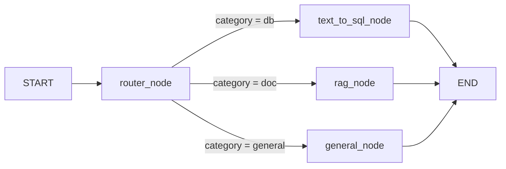

# System Architecture

- **LangGraph State (`GraphState`):** A `TypedDict` tracking `question`, `category`, `sql_query`, `sql_result`, `retrieved_docs`, and `final_answer`.
- **Nodes:**
  1. `router_node`: Uses LLM to determine category (`db`, `doc`, `general`).
  2. `text_to_sql_node`: Generates a SQL query, executes it via `SQLDatabase`, and synthesizes a natural language answer.
  3. `rag_node`: Embeds query, searches ChromaDB, applies `FlashrankRerank` via `ContextualCompressionRetriever`, and synthesizes an answer.
  4. `general_node`: Directly prompts the LLM to answer the question.
- **Edges:** Conditional edge from `router_node` to the other three nodes based on the `category` value, then to `END`.

## Architecture diagram

```mermaid
flowchart TD
  user[User]
  ui[Streamlit app.py]
  env[".env credentials"]
  graph[LangGraph graph.py]
  router[router_node]
  sql[text_to_sql_node]
  rag[rag_node]
  general[general_node]
  mysql[(MySQL ev_fleet)]
  chroma[(ChromaDB)]
  flash[FlashrankRerank]
  gemini[Google Gemini]
  docs[Uploaded txt or pdf]
  answer[final_answer]

  user --> ui
  env --> ui
  docs --> ui
  ui -->|"ingest documents"| chroma
  ui -->|"question"| graph
  graph --> router
  router -->|"Gemini classifies db doc general"| gemini
  router -->|"db"| sql
  router -->|"doc"| rag
  router -->|"general"| general
  sql --> mysql
  sql --> gemini
  rag --> chroma
  chroma --> flash
  flash --> rag
  rag --> gemini
  general --> gemini
  sql --> answer
  rag --> answer
  general --> answer
  answer --> ui
  ui --> user
```

## LangGraph routing


